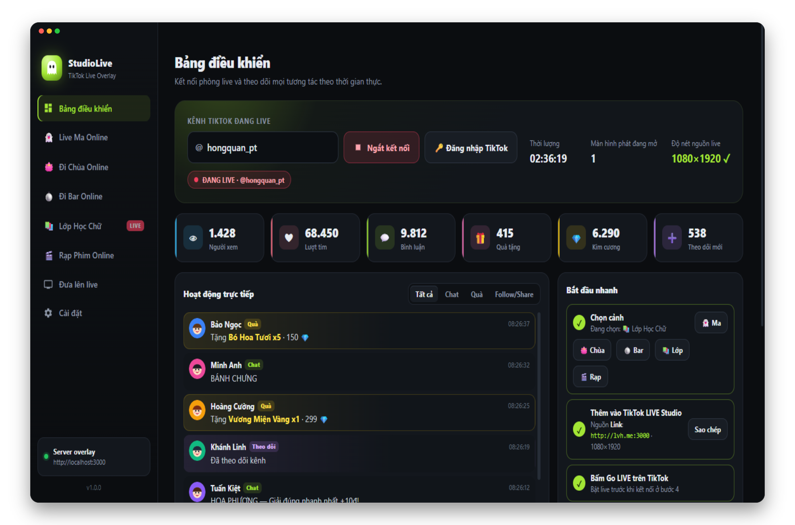
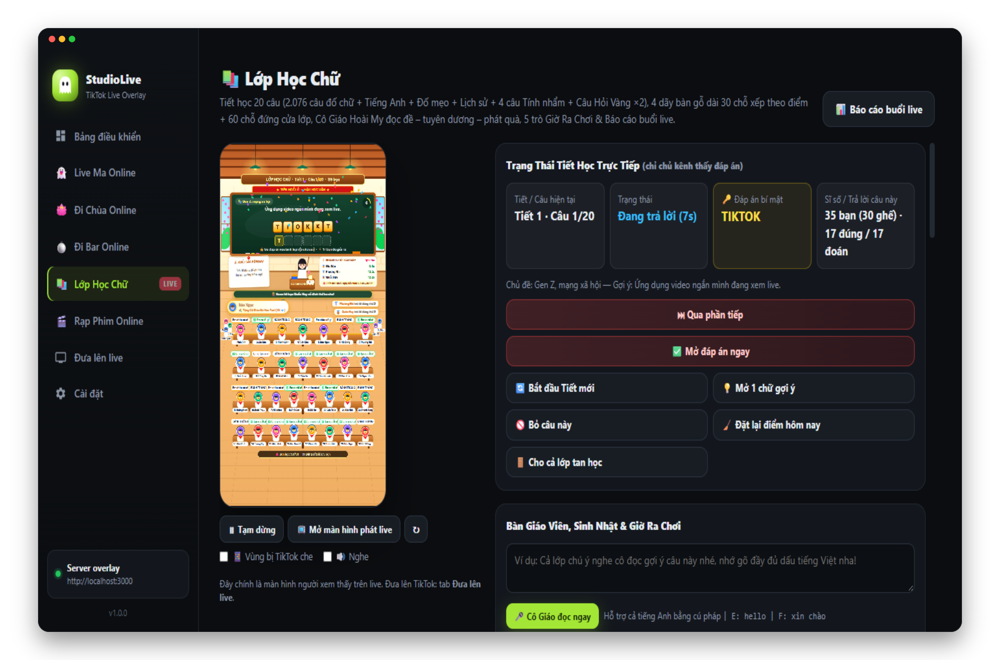
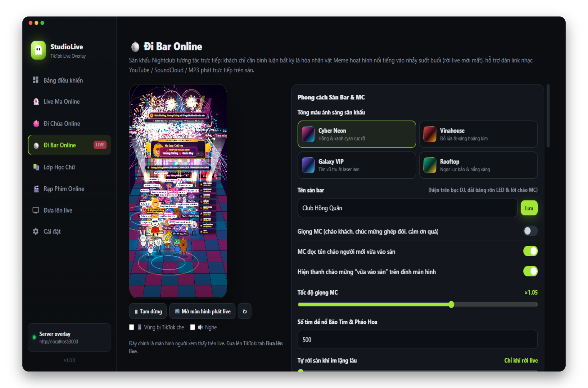
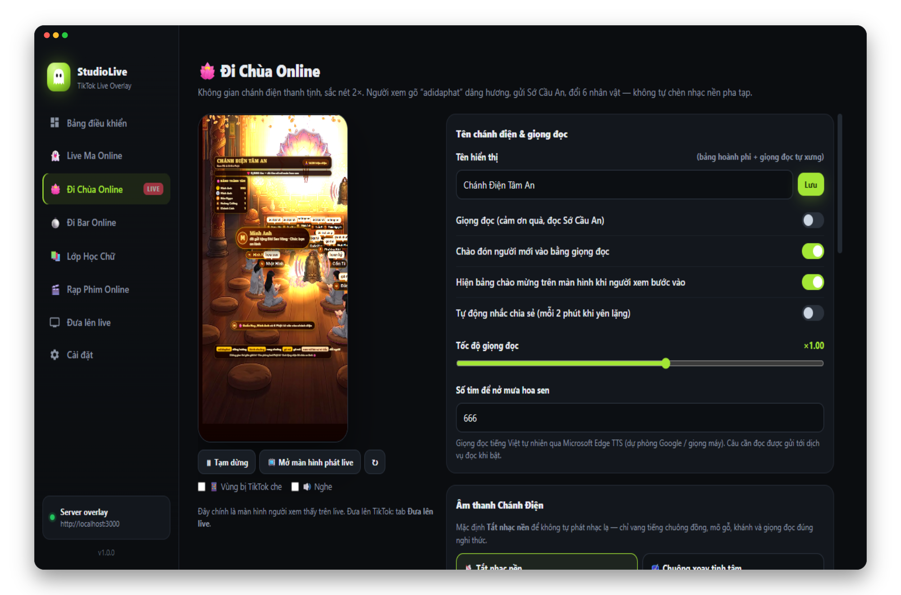
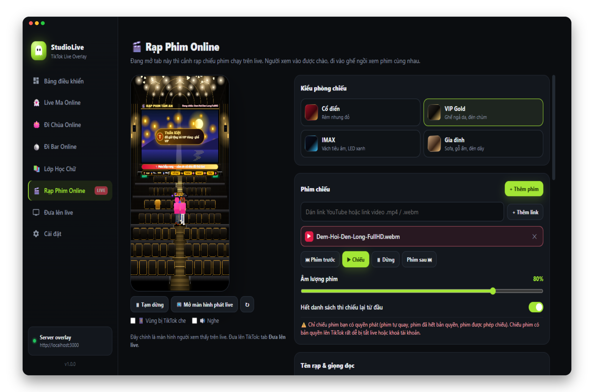
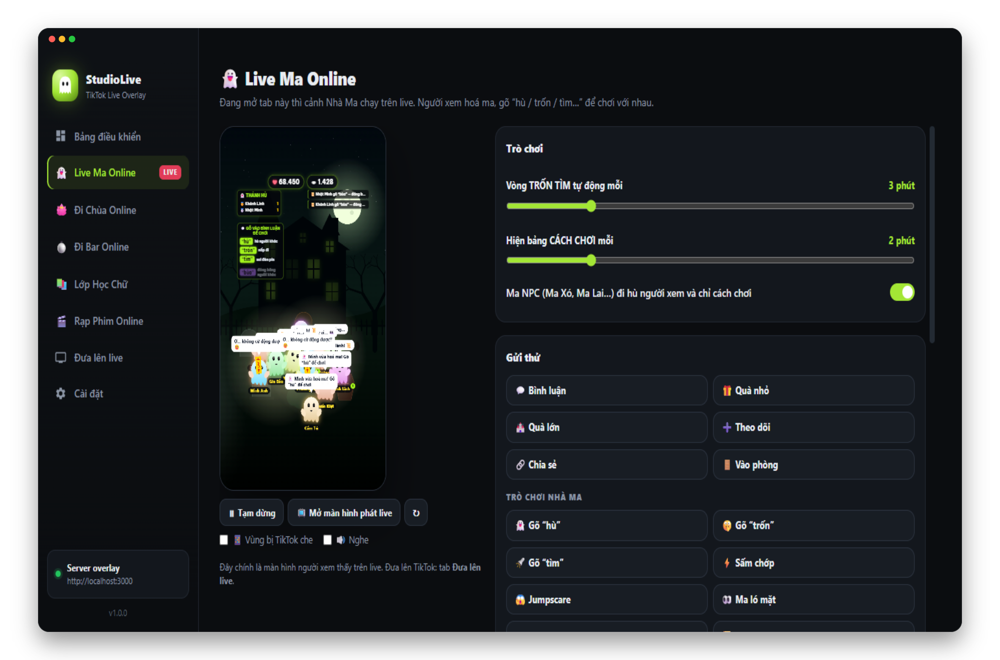

# StudioLive — 5 Cảnh Tương Tác Trực Tiếp Cho TikTok LIVE

[](https://www.tiktok.com/@hongquan_pt)
[](https://github.com/hongquanpt)
[](LICENSE)


Ứng dụng máy tính tạo **5 phòng tương tác tự động theo thời gian thực cho TikTok LIVE**, chạy hoàn toàn trên máy của bạn (không cần lộ mặt, không cần Stream Key). Người xem chỉ cần vào phòng, bình luận, thả tim hoặc tặng quà là lập tức hoá thân thành nhân vật trên màn hình cùng giọng đọc AI dẫn dắt tự động.

> 🎬 **Khám phá thêm nhiều phần mềm hay:** Để theo dõi các bản cập nhật mới nhất và xem thêm nhiều phần mềm, công cụ thú vị khác, hãy nhấn Follow kênh TikTok của mình tại **[@hongquan_pt](https://www.tiktok.com/@hongquan_pt)** nhé!

> ⚠️ **Đọc kỹ [Tuyên bố miễn trừ trách nhiệm](DISCLAIMER.md) trước khi sử dụng.** Nghiêm cấm dùng StudioLive để lừa đảo, trục lợi, lợi dụng tín ngưỡng, vi phạm bản quyền hay livestream trái pháp luật.



---

## 🌟 5 Chế Độ Tương Tác ("5 Trong 1")

Mở tab cảnh nào trong ứng dụng thì cảnh đó hiển thị trực tiếp trên buổi live (khung dọc chuẩn Full HD `1080 × 1920`, nằm gọn trong vùng an toàn của TikTok):

| 📚 Lớp Học Chữ | 🪩 Đi Bar Online |
|---|---|
|  |  |

| 🪷 Đi Chùa Online | 🎬 Rạp Phim Online | 👻 Live Ma Online |
|---|---|---|
|  |  |  |

### 1. 📚 Lớp Học Chữ (`overlay/lop.js`)
- **Kho 2.076 câu đố tiếng Việt** chia **30 chủ đề** (Trường lớp, Con vật, Món ăn Việt, Ca dao thành ngữ, Địa danh, Gen Z, Tuổi thơ 8x 9x…) kết hợp câu hỏi **Tiếng Anh, Đố mẹo, Lịch sử**, xen kẽ **4 bài Toán tính nhẩm** (câu 5, 10, 15, 19) và **Câu Hỏi Vàng ×2 điểm** ở câu 20.
- **Cô Giáo Hoài My AI** tự đọc đề (phát âm chuẩn cả tiếng Việt lẫn tiếng Anh), hô *"Bắt đầu!"* mới mở ô chữ & đếm ngược; tự động cộng thêm +10 giây & mở chữ gợi ý khi cả lớp chưa giải ra; tuyên dương & phát quà sau câu 5, 10, 15; hỗ trợ tổ chức sinh nhật ngay trên lớp.
- **4 dãy bàn gỗ dài (30 chỗ ngồi)** tự xếp chỗ theo điểm tiết + **60 chỗ đứng cửa lớp**, tuỳ chọn 2 kiểu nhân vật (*Avatar TikTok tròn quàng khăn đỏ* hoặc *Học sinh quay lưng 10 kiểu tóc*) và **5 tông màu phòng học**.
- **5 trò Giờ Ra Chơi** luân phiên: *Oẳn tù tì, Kiểm tra miệng, Chọn phe 1/2, Điểm danh "có mặt", Thử thách thả tim*.
- Khách tặng quà ôm bó hoa lên bục cắm vào bình, quà lớn mở chữ cứu cả lớp. Hỗ trợ tự soạn thêm câu hỏi riêng, lưu chuỗi điểm danh chuyên cần, Bảng Vàng tuần và trang **Báo cáo buổi live** (`/lop-bao-cao`).

### 2. 🪩 Đi Bar Online (`overlay/bar.js`)
- **Sân khấu Nightclub / Vinahouse 2× HiDPI:** Người xem chỉ cần bình luận bất kỳ là hoá thành nhân vật Meme hoạt hình gắn **Avatar TikTok phát sáng** bước vào sàn nhảy xuyên suốt buổi live.
- **Tương tác bằng bình luận (tuỳ chỉnh được từ khoá):** `lên chính` (bước lên tâm điểm sân khấu), `pháo hoa`, `nhảy 1 cái`, `camera`, `đổi nv`, `đi vòng` (cả sàn đi bão), `phi công`, `ghép đôi`, `ngộ không`, `vua`, `123 dzô`…
- **Bàn điều khiển DJ & MC AI:** 4 tông ánh sáng (*Cyber Neon, Vinahouse, Galaxy VIP, Rooftop*), MC đọc tên chào khách mới, chúc mừng ghép đôi, vinh danh đại gia (*Bá Chủ, Á Vương, Tam Hoàng*), bắn pháo hoa, xả khói CO2, đại tiệc Laser & Bass Drop.
- **Nhạc sàn linh hoạt:** Beat EDM 128 BPM / Lounge Chill 110 BPM tự tạo sạch bản quyền, hoặc dán trực tiếp **link YouTube / SoundCloud / MP3** và chọn file nhạc trên máy.

### 3. 🪷 Đi Chùa Online (`overlay/temple.js`)
- **Chánh điện thanh tịnh 2× HiDPI:** Người xem hoá Phật tử ngồi bồ đoàn (6 kiểu nhân vật), bình luận từ khoá (`adidaphat`, `thỉnh chuông`, `gõ mõ`, `hoa sen`, `hoan hỷ`, `mưa hoa` — cho phép thêm/sửa cụm từ riêng) để lên dâng hương, thỉnh chuông, gõ mõ hoặc gửi **Sớ Cầu An**.
- Quà tặng làm nở đài sen vàng kèm giọng đọc cảm ơn và chúc bình an; đủ mốc tim nổ mưa cánh sen; 4 chế độ âm thanh chánh điện (*Tắt nhạc nền, Chuông xoay tịnh tâm, Nhịp mõ tịnh niệm, Nhạc MP3 tự chọn*).

### 4. 🎬 Rạp Phim Online (`overlay/rap.js`)
- **Phòng chiếu 84 ghế:** Đón chào người xem bước vào ghế ngồi xem chung danh sách phát (link YouTube, link `.mp4`/`.webm` hoặc file video trên máy).
- Gõ `vỗ tay` / `haha` / `wow` / `bắp` để tung hiệu ứng cảm xúc; tặng quà lên **ghế VIP vàng**; đủ mốc tim nổ mưa bắp rang. Có **4 phong cách phòng chiếu**: *Cổ điển, VIP Gold, IMAX, Gia đình* cùng chế độ tắt đèn rạp.

### 5. 👻 Live Ma Online (`overlay/game.js`)
- **Ngôi nhà ma tương tác:** Người xem hoá ma bay trong phòng, gõ `hù` / `trốn` / `tìm` / `bùa` / `gọi hồn` / `tắt đèn` / `ôm` / `nhảy` / `cười` / `khóc`… chơi cùng nhau và với Ma NPC.
- Quà lớn triệu hồi **Bà Ma + Jumpscare**; vòng **TRỐN TÌM** tự động định kỳ; **8 kiểu âm thanh nền rùng rợn** (*U ám, Gió hú, Mưa đêm, Nhà thờ hoang, Hồi hộp, Hộp nhạc ma, Thì thầm, Rừng đêm*) hoặc chế độ nền trong suốt đè lên camera.

---

## 🚀 Cài Đặt & Chạy Ứng Dụng

### Cách 1: Chạy trực tiếp từ mã nguồn (Khuyên dùng / Nhà phát triển)

Yêu cầu cài sẵn **[Node.js 18+](https://nodejs.org/)** và **Git**.

```bash
git clone https://github.com/hongquanpt/StudioLive.git
cd StudioLive
npm install
npm start
```

### Cách 2: Tải bộ cài đóng gói sẵn (Người dùng phổ thông)

Nếu có bản phát hành đóng gói sẵn tại mục **[Releases](https://github.com/hongquanpt/StudioLive/releases)**:

- **Windows 10/11 (64-bit):** Chạy file `StudioLive-Setup-<phiên_bản>-win-x64.exe` → chọn thư mục → **Install**. *(Nếu SmartScreen hiện cảnh báo do app chưa ký số: bấm **More info → Run anyway**).*
- **macOS 12+ (Apple Silicon `arm64` / Intel `x64`):** Mở file `.dmg`, kéo **StudioLive** vào **Applications** → chuột phải chọn **Mở (Open)**. Nếu báo *"StudioLive bị hỏng và không thể mở"*, chạy lệnh sau trong Terminal rồi mở lại:
  ```bash
  xattr -cr /Applications/StudioLive.app
  ```

---

## 📺 Hướng Dẫn Đưa Lên TikTok LIVE (4 Bước)

1. **Chọn cảnh:** Mở StudioLive, bấm chọn 1 trong 5 tab cảnh (👻 Ma / 🪷 Chùa / 🪩 Bar / 📚 Lớp / 🎬 Rạp) ở thanh bên trái.
2. **Thêm vào TikTok LIVE Studio (hoặc OBS):**
   - **TikTok LIVE Studio:** Chọn khung **dọc (9:16)** → Thêm nguồn **Link** → dán `http://lvh.me:3000` → đặt kích thước **`1080 × 1920`**, kéo phủ vừa khít khung. *(Dùng `lvh.me` vì LIVE Studio chặn chữ `localhost`; `lvh.me` luôn trỏ về chính máy bạn).*
   - **OBS Studio:** Thêm nguồn **Browser** → dán `http://localhost:3000`, kích thước **`1080 × 1920`**, bật *Control audio via OBS*.
3. **Bấm Go LIVE** trên TikTok LIVE Studio / OBS.
4. **Kết nối phòng live:** Quay lại tab **Bảng điều khiển** của StudioLive, nhập `username` kênh TikTok đang live (không cần `@`) → bấm **Kết nối**. *(Nếu phòng live 18+ hoặc bị TikTok hỏi xác minh, bấm nút **🔑 Đăng nhập TikTok** ngay cạnh để đăng nhập một lần).*

> 💡 **Mẹo:** Khi chưa bật live thật, bạn vẫn có thể trải nghiệm toàn bộ hiệu ứng và giọng đọc bằng các nút **Gửi thử** trong từng tab cảnh. Xem hướng dẫn chi tiết cách chỉnh nét, chống bạc màu và xử lý lỗi tại **[docs/HUONG-DAN-CAI-DAT.md](docs/HUONG-DAN-CAI-DAT.md)**.

---

## 🛠️ Lệnh Đóng Gói & Công Cụ Đi Kèm

```bash
# Chạy ứng dụng chế độ phát triển
npm start

# Đóng gói bộ cài Windows (.exe NSIS x64 trong thư mục dist/)
npm run dist:win

# Đóng gói bộ cài macOS (.dmg + .zip cho arm64 và x64 trong thư mục dist/)
npm run dist:mac

# Tự động quay & xuất video quảng cáo Full HD 1080x1920 kèm giọng AI
npm run promo -- --contact "Zalo / Hotline: 09xx.xxx.xxx"
```

Chi tiết đóng gói và kiểm thử tự động (`STUDIO_SELFTEST`): xem **[docs/BUILD.md](docs/BUILD.md)**.

---

## 📂 Cấu Trúc Dự Án

```text
src/main.js            Tiến trình chính Electron: cửa sổ, IPC, dữ liệu thử, tự kiểm tra
src/live.js            Quản lý kết nối TikTok LIVE, chuẩn hoá sự kiện, tự kết nối lại
src/direct.js          Đọc sự kiện phòng live qua trình duyệt ẩn + giải mã protobuf (tiktok-live-connector 2.0.0)
src/server.js          Server Express + Socket.IO (127.0.0.1) phát overlay, proxy nhạc & /api/tts, /lop-bao-cao
src/tts.js             Giọng đọc AI tiếng Việt & tiếng Anh (Microsoft Edge TTS, tự chuyển dự phòng Google TTS)
src/settings.js        Quản lý & lưu trữ cấu hình người dùng trong thư mục userData
src/lopStore.js        Lưu sổ lớp học, câu hỏi đã dùng/bỏ qua, chuỗi chuyên cần & báo cáo buổi live
src/preload.js         Cầu nối IPC an toàn giữa tiến trình chính và giao diện điều khiển
renderer/              Giao diện bảng điều khiển (index.html, app.js, styles.css)
overlay/               Màn hình phát trực tiếp 1080×1920:
  ├── lop.js, lop-data.js   Cảnh Lớp Học Chữ & kho 2.076 câu đố 30 chủ đề
  ├── bar.js                Cảnh Đi Bar Online (Nightclub / Meme Avatar / DJ)
  ├── temple.js             Cảnh Đi Chùa Online & thư mục tài nguyên chua-assets/
  ├── rap.js                Cảnh Rạp Phim Online
  ├── game.js, faces.js     Cảnh Live Ma Online
  └── audio.js, overlay.js  Bộ tổng hợp âm thanh WebAudio, điều phối cảnh & giọng đọc
promo/                 Công cụ tự động tạo video giới thiệu & bộ kịch bản đăng bài
docs/                  Hướng dẫn cài đặt, hướng dẫn đóng gói & thông báo bản quyền bên thứ ba
build/icon.png         Biểu tượng ứng dụng
```

- Dữ liệu cài đặt lưu tại: `%APPDATA%\StudioLive\settings.json` (Windows) hoặc `~/Library/Application Support/StudioLive/settings.json` (macOS).
- Lưu ý: Giữ `tiktok-live-connector` ở phiên bản **`2.0.0`** (giấy phép MIT); các bản mới hơn chuyển sang AGPL-3.0.

---

## 🤝 Đóng Góp & Giấy Phép

- Mọi đóng góp đều được chào đón: Fork repository → tạo nhánh mới → commit → mở Pull Request, hoặc báo lỗi/đề xuất tính năng tại **[Issues](https://github.com/hongquanpt/StudioLive/issues)**.
- Mã nguồn phát hành theo giấy phép **[MIT](LICENSE)** — © 2026 **[hongquanpt](https://github.com/hongquanpt)**.
- Các thư viện và tài nguyên bên thứ ba giữ nguyên giấy phép gốc: xem **[docs/THIRD_PARTY_NOTICES.md](docs/THIRD_PARTY_NOTICES.md)**.
- Việc sử dụng phần mềm phải tuân thủ **[Tuyên bố miễn trừ trách nhiệm (DISCLAIMER.md)](DISCLAIMER.md)**. StudioLive không liên kết với TikTok / ByteDance.

## 👤 Tác Giả & Kênh Theo Dõi

**hongquanpt**
- 🎵 **TikTok:** [@hongquan_pt](https://www.tiktok.com/@hongquan_pt) — *Hãy theo dõi kênh TikTok của mình để xem hướng dẫn sử dụng trực quan và cập nhật thêm nhiều phần mềm mới hơn nhé!*
- 💻 **GitHub:** [@hongquanpt](https://github.com/hongquanpt)
- 📦 **Repository:** [github.com/hongquanpt/StudioLive](https://github.com/hongquanpt/StudioLive)

## ☕ Mời Tác Giả Ly Cà Phê

Nếu StudioLive giúp ích cho bạn, có thể mời mình một ly cà phê để có thêm động lực phát triển thêm nhiều phần mềm mới. Hoàn toàn tự nguyện — ứng dụng vẫn miễn phí cho tất cả mọi người. Cảm ơn bạn! 💚

<p align="center">
  
</p>

<p align="center"><sub>Quét bằng ứng dụng ngân hàng bất kỳ hỗ trợ VietQR / Napas 247.</sub></p>
